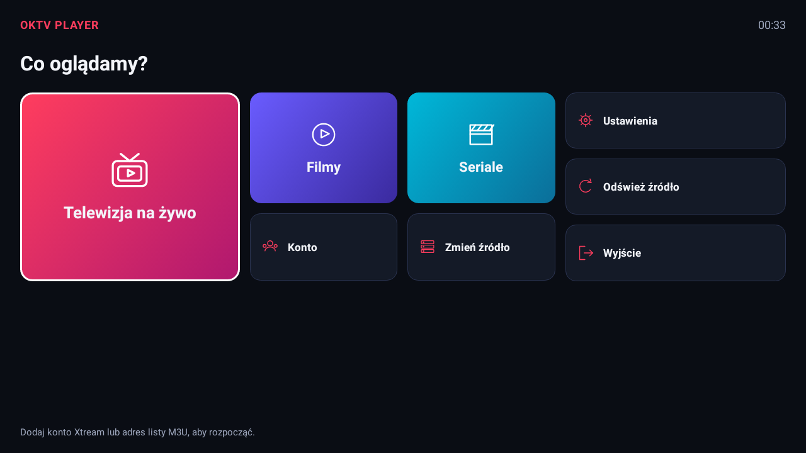
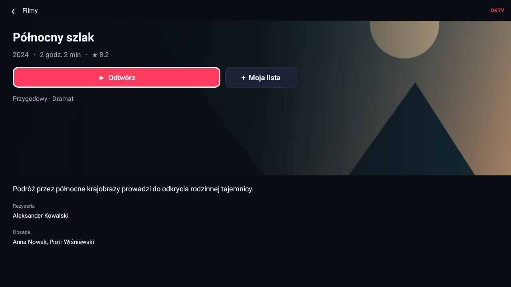
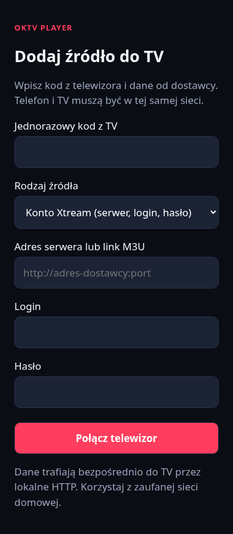

# OKTV Player TV 0.9.3 Preview

Wersja TV korzysta ze stylistyki OKTV Player 1.1.6: różowo-czerwonego kafelka telewizji, fioletowego kafelka filmów i turkusowego kafelka seriali, wspólnych rysowanych ikon oraz czerwonych akcentów na ciemnym tle. Nazwa aplikacji i banner w launcherze TV to OKTV Player. Formularz telefonu również używa granatowego tła i czerwonego akcentu OKTV.

Ekran główny ma układ poziomy z czytelnym fokusem pilota. Zawiera Konto, Zmień źródło, Ustawienia, Odśwież źródło i Wyjście. Konto pokazuje serwer oraz liczbę kanałów i bukietów, bez loginu i hasła. W ustawieniach są źródło, bufor, własne XMLTV i informacje o aplikacji.

Filmy i seriale korzystają z plakatów 2:3, kategorii, wyszukiwania i ulubionych. Wybór filmu otwiera ekran szczegółów oparty na ekranie telefonu 1.1.6: obraz, rok, długość, ocena, opis, obsada, Odtwórz/Kontynuuj, Moja lista i Od początku. Przy braku metadanych pozostaje dostępny oryginalny strumień. Przycisk odtwarzania i pozycja są przekazywane do odtwarzacza TV. Menu pozycji pozwala też uruchomić film bezpośrednio.

Seriale zachowują wybór sezonu, odcinki, miniatury i postęp, z przyciskami w stylu OKTV. Wspólne gradienty i ikony są w `HomeStyle`, a szczegóły filmów i repozytorium metadanych we wspólnym źródle aplikacji telefonu i TV.

Zachowane poprawki 0.9.2: parowanie przez telefon w LAN, jednorazowy kod QR/PIN, szyfrowanie konta, ponowienia odtwarzania, ochrona pasma przed pobraniami EPG w tle, recykling widoków, katalogi z pamięci i zachowanie filmów/seriali podczas odświeżania.

## Instalacja i sprawdzenie

APK: `OKTV-Player-TV-0.9.3-preview.apk`, applicationId `pl.tvplayer.television`, versionCode 4. Używa tego samego klucza Preview, więc aktualizacja zachowuje bibliotekę. Fire OS 6+ / Android TV 7.1+; Vega OS nie jest obsługiwany.

```sh
gradle :app:testDebugUnitTest :app:lintDebug :tv:lintDebug :app:assembleDebug :tv:assembleDebug :tv:assembleDebugAndroidTest
gradle :tv:connectedDebugAndroidTest
```

Testy pilota obejmują kolorowe menu, konto, ustawienia, źródło przez telefon, wybór filmu, szczegóły, ulubione, oryginalny adres strumienia i restart filmu M3U bez API metadanych. CI sprawdza też ponawianie odtwarzania i ograniczanie pobrań XMLTV.

Push i pull request uruchamiają weryfikację bez publikowania wydania. Prerelease TV jest publikowany przez ręczne uruchomienie workflow TV platforms; starsze tagi pozostają bez zmian. Telefon ma nadal własny numer 1.1.6, a 0.9.3-preview identyfikuje pakiet TV.

## Rzeczywiste ekrany

Zrzuty z APK na emulatorze. Dane filmu i grafika są pokazowe.







## Wynik weryfikacji

- 94 testy jednostkowe: zaliczone.
- 15 testów na emulatorze Android 7.1/API 25: zaliczone (menu i pilot, filmy, seriale, QR, odtwarzanie i EPG).
- Dodatkowe 3 scenariusze powtórzone z końcowym APK: zaliczone.
- Formularz telefonu w Chromium: przełączanie Xtream/M3U, czerwony przycisk OKTV i przesłanie danych — zaliczone.
- Android Lint, kompilacja aplikacji telefonu i TV, podpis APK v2 oraz składnia workflow i skryptu CI: poprawne.

Testy używają lokalnego serwera i danych pokazowych. Długiego odtwarzania z kontem użytkownika na fizycznym TV nie sprawdzano.
