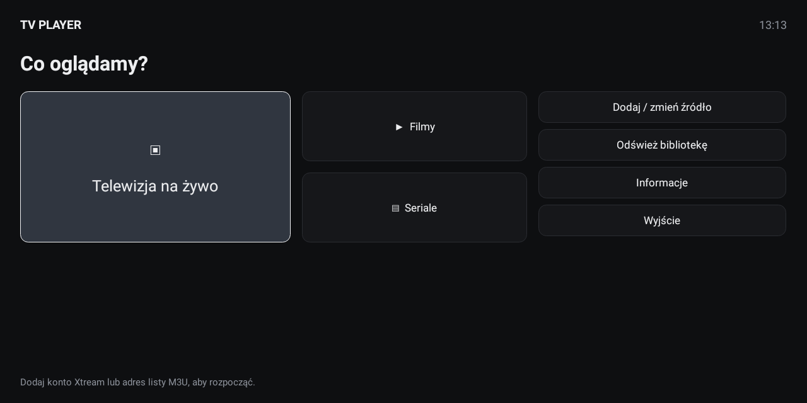
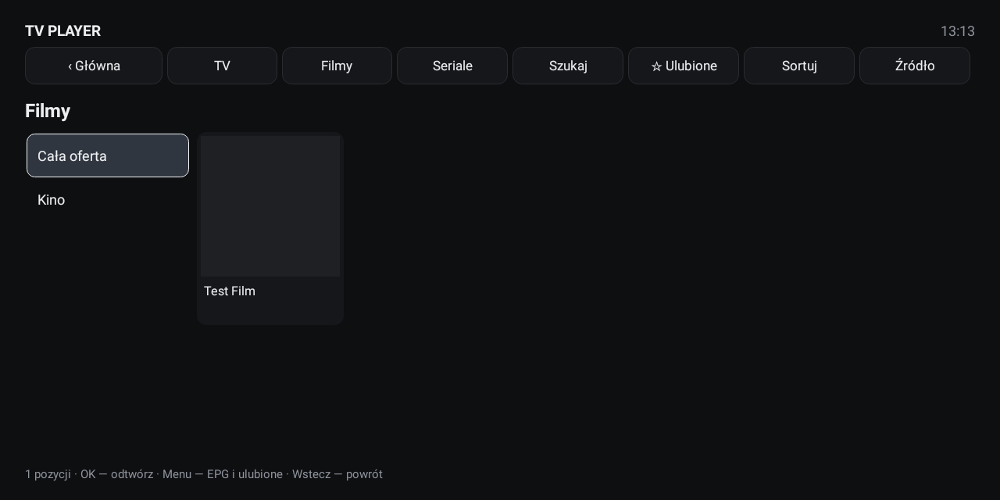
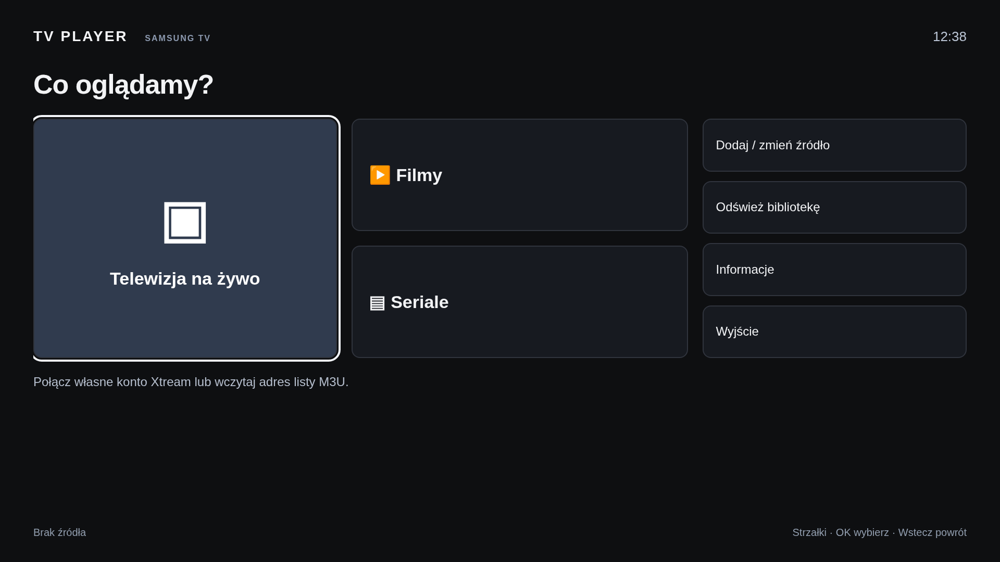
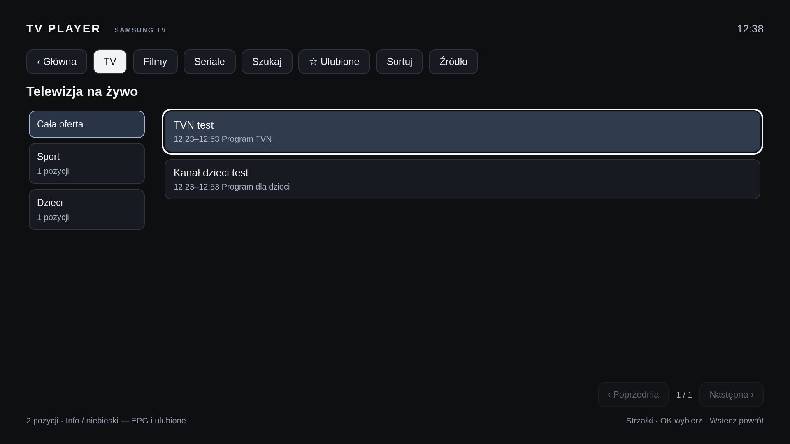
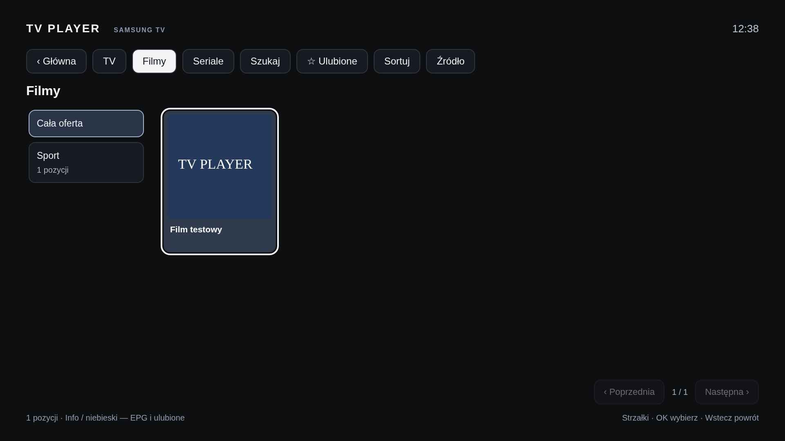

# TV Player TV 0.9.0

## Fire TV / Android TV — renderowanie natywne na emulatorze API 25

## Samsung Tizen — test przeglądarkowy, AVPlay zastąpione atrapą API

Samsung wymaga certyfikatu urządzenia przed instalacją. Te zrzuty nie potwierdzają dekodowania materiału na fizycznym TV.
